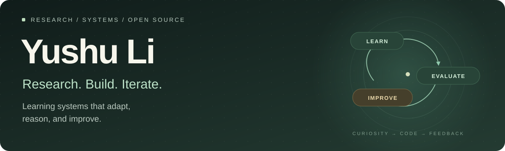
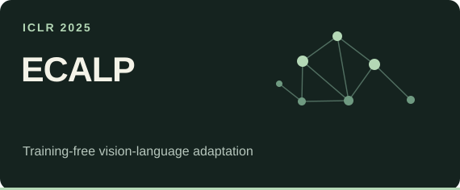
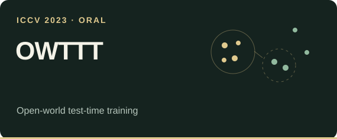

  

  <b>Applied Scientist Intern @ AWS</b> 
  PhD Student @ UBC ECE &nbsp;·&nbsp; Student Researcher @ Vector Institute

  <a href="https://yushu-li.github.io/"><b>Website & Publications ↗</b></a>
  &nbsp;&nbsp; / &nbsp;&nbsp;
  <a href="https://scholar.google.com/citations?user=lKkYV2AAAAAJ"><b>Google Scholar ↗</b></a>
  &nbsp;&nbsp; / &nbsp;&nbsp;
  <a href="https://www.linkedin.com/in/yushu-li-475773288"><b>LinkedIn ↗</b></a>
  &nbsp;&nbsp; / &nbsp;&nbsp;
  <a href="https://yushu-li.github.io/files/Yushu_Li_Resume.pdf"><b>CV ↗</b></a>

I’m Yushu, an AI researcher interested in how learning systems **adapt, reason, and improve through feedback**. At AWS, I work on robust and efficient reinforcement learning. I also enjoy turning ideas into useful tools and contributing fixes to software people use.

## 01 / Research interests

<table>
  <tr>
    <td width="50%" valign="top">
      <h3>◈ &nbsp; Reward Hacking</h3>
      
Understanding when optimizing a reward misses the intended goal—and how to make reinforcement learning more reliable.

      REWARD DESIGN &nbsp; / &nbsp; RELIABLE RL
    </td>
    <td width="50%" valign="top">
      <h3>↗ &nbsp; Efficient AI</h3>
      
Getting more useful reasoning and learning from limited computation, with a focus on budget-aware agents and efficient RL.

      REASONING BUDGETS &nbsp; / &nbsp; EFFICIENCY
    </td>
  </tr>
  <tr>
    <td width="50%" valign="top">
      <h3>⌘ &nbsp; LLM Agents & Reasoning</h3>
      
Exploring tool use, search, and evaluation to help agents solve real tasks and learn from their outcomes.

      TOOL USE &nbsp; / &nbsp; SEARCH &nbsp; / &nbsp; FEEDBACK
    </td>
    <td width="50%" valign="top">
      <h3>◎ &nbsp; Adaptation & Robustness</h3>
      
Helping models handle distribution shifts and unfamiliar classes through test-time adaptation and vision-language learning.

      TEST-TIME ADAPTATION &nbsp; / &nbsp; OPEN WORLD
    </td>
  </tr>
</table>

## 02 / Selected work

<table>
  <tr>
    <td width="50%" valign="top">
      
      
<b>Adapt without retraining.</b> Context-aware label propagation for zero- and few-shot adaptation of vision-language models.

      <a href="https://github.com/Yushu-Li/ECALP"><b>Explore the code ↗</b></a>
    </td>
    <td width="50%" valign="top">
      
      
<b>Adapt to an open world.</b> Robust test-time training with self-training and dynamic prototype expansion.

      <a href="https://github.com/Yushu-Li/OWTTT"><b>Explore the code ↗</b></a>
    </td>
  </tr>
</table>

More research on reward hacking, agentic RL, and efficient reasoning lives on my <a href="https://yushu-li.github.io/#-publications"><b>publications page ↗</b></a>.

## 03 / Currently exploring

- **Agent RSI** — recursive self-improvement through feedback, evaluation, and iteration.
- **Jev** — structured, probabilistic decisions and how they fit into agent systems.
- **AI as an enabler** — small tools and automations that make something useful possible with less effort.

## 04 / Open source, in practice

I like contributions with a concrete outcome: a bug fixed, a workflow simplified, or an experiment made easier to run.

<a href="https://github.com/algorithmicsuperintelligence/openevolve"><b>OpenEvolve</b></a> · Selected merged contributions

| Contribution | What it enables |
| :--- | :--- |
| [Evaluator interoperability · #519](https://github.com/algorithmicsuperintelligence/openevolve/pull/519) | Running local AlphaEvolve evaluators with OpenEvolve. |
| [Experiment configuration import · #520](https://github.com/algorithmicsuperintelligence/openevolve/pull/520) | Reusing AlphaEvolve experiment configurations in OpenEvolve. |

<a href="https://github.com/pulls?q=is%3Apr+author%3AYushu-Li+is%3Amerged"><b>More merged contributions ↗</b></a>

---

Outside research, I enjoy experimenting with **AI-assisted video creation** and automating repetitive work—using AI to gain new capabilities and leave something useful behind.

> **Build something small. Make it work. Get a real result. Then iterate.**

Open to conversations about research, practical AI systems, and useful open source.

